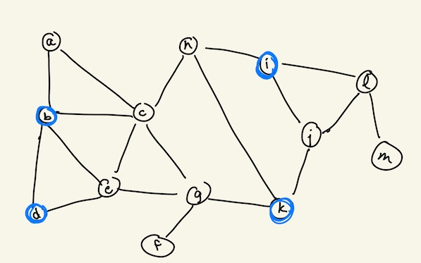
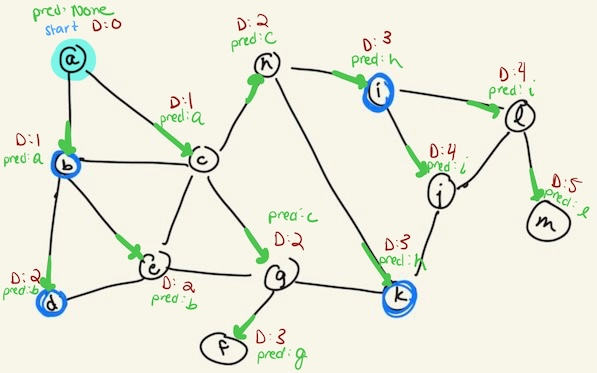
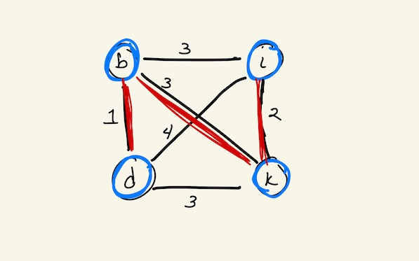
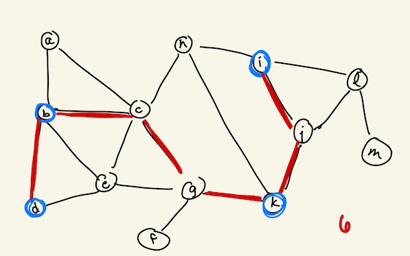
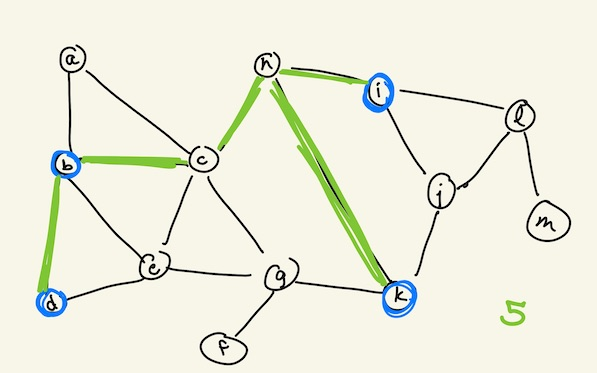
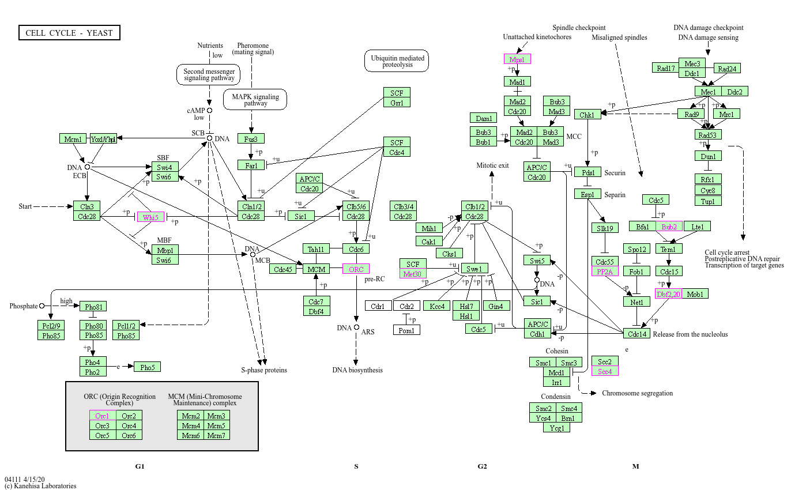

# P3: Steiner Tree Approximation
**Out: M 10/5 :arrow_right: Due: M 10/12 :arrow_right: Resubmission Due: M 11/9**

**Purpose:** You will implement a Steiner tree approximation on a small, unweighted, connected graph. This algorithm will use previous code from assignments and labs, and you will also write some new functions. There are four parts to writing the function:
1. Compute the shortest paths in an unweighted graph.
2. Compute the metric closure of the graph.
3. Compute the minimum spanning tree (MST) of the metric closure.
4. Expand the MST into edges from the original graph.

There are optional extensions to work on weighted graphs and larger graphs.

**Assignments are Initially Graded as M/P/C:** There are 6 tasks in this assignment (two data structures in Part 1, two data structures in Part 2, and one task each in Parts 3 & 4) and 2 "Readable Code" pieces. Some tasks have tests; others will be manually checked. Refer to the [Types of Work](https://reed-compbio-classes.github.io/bio331-syllabus/doc/typesofwork/#programming-assignments) and the [Grading Contract](https://reed-compbio-classes.github.io/bio331-syllabus/doc/gradingcontract/) in the syllabus for more information. **There are 8 total pieces: 0-3 is Missing, 4-5 is Partial, 6-8 is Complete.** 

| Task | # Tests | Pieces | Notes | 
| -- | -- | -- | -- | 
| 1A: Shortest Paths Distance Dictionary | 1 | 1 | Modify code from L2 |
| 1B: Shortest Paths Predecessor Dictionary | 1 | 1 |  |
| 2A: Metric Closure Predecessor Dictionary | 1 | 1 | |
| 2B: Metric Closure Edges | 1 | 1 |  |
| Parts 1 & 2 Readable Code | 0 | 1 | See description below.  | 
| 3: Min Spanning Tree | 1 | 1 | |
| 4: Expand MST | 0 | 1 | Use the provided `utils.get_path()` function | 
| Parts 3 & 4 Readable Code | 0 | 1 | See description below. | 
| **Total** | **5** | **8** | 

The "Readable Code" criterion means that your code is organized in a coherent way and you use comments throughout your code to explain any tricky parts. You are responsible for adding comments within the functions and comments that describe each function. Specifically, I am looking for:
- Consistent conventions and clear variable names (however you choose to comment, be consistent).
- Use of whitespace and linebreaks to separate sections of code within a function.
- In-line comments that explain the rationale of any tricky parts. 
- Removal of comment stubs (e.g., the `# write code here` comments).

At any point you can type `pytest` in the terminal to see which tests pass. These tests are located in `test_run.py`, so you can see which examples pass and fail and debug your program.

:exclamation: Do not modify `test_run.py`. If you’d like to experiment with your own tests, create a new file beginning with `test_`, which pytest will also detect.

**Resubmitting for an Improved Grade (including an E):** Once you have received feedback, you can resubmit your assignment addressing that feedback to improve your grade. Email me once you've resubmitted so I know to look for it. To be eligible for an Excellent on this assignment, you must do the following:
1. Address all of the feedback to complete all pieces above (including passing tests and having readable code).

2. Add a `REFLECTION.txt` file with a structured description of all your changes (click the '+' document icon in the File Explorer to add a new file and name the file `REFLECTION.txt`). The purpose of this document is to think holistically about the assignment and how you could improve your skills. 

   -  First write a paragraph about the assignment as a whole and how you felt you did in the initial submission. 
   - Then, for each piece of feedback you received (a failing test, feedback on written answers, issues with code readability or organization, etc.), you must 
   
     - write what was originally incorrect or incomplete, 
     - summarize your change(s), and 
     - describe what misconception or mistake led to the issue and how you'll apply that understanding in future submitted work. 

     Here is an example entry: _Issue: In 1A, I printed the adjacency matrix using for `i in range(len(nodes)+1):`, which caused an "IndexError: list index out of range" when it tried to access `adj_mat[len(nodes)]` — one row past the last valid index. Change: I changed the loop to `for i in range(len(nodes)):` so it stops at the last valid index instead of going one past it. What I learned: I mixed up `range(len(nodes)+1)` (which counts 0 through len(nodes), one too many) with `range(len(nodes))` (which correctly counts 0 through len(nodes)-1). Next time I'll check a loop's range against the actual list length before running the code, especially in nested loops._

:exclamation: Note that meeting these two requirements makes you eligible for an Excellent — it isn't awarded automatically. I'm looking for genuinely thoughtful reflection and correct, clean work, not just a checked box. Depending on your familiarity with programming, I may also require at least one optional extension.

**Useful References:** Refer to the [Bio131 Python Crashcourse](https://reed-compbio-classes.github.io/python-crashcourse/) for Python programming syntax and your previous labs and assignments. You may copy any of your previous functions - be sure to note this as a comment in your code.

**Resources and Collaborations:** You should document any online resources or collaborations in the `RESOURCES_COLLABORATIONS.txt` file. 
- :alien: [[AI policy](https://reed-compbio-classes.github.io/bio331-syllabus/doc/policies/#online-resources--generative-ai-policy)] Generative AI is allowed for basic Python syntax and to help debug, but you may not look up the code for entire functions that are part of an assignment or lab. 
- :computer: [[Resources policy](https://reed-compbio-classes.github.io/bio331-syllabus/doc/policies/#online-resources--generative-ai-policy)] Do not use python packages that provide code for working with graphs (e.g., networkx or igraph) or other math/stats packages (e.g., scipy or numpy) unless otherwise directed. 
- :handshake: [[Collaboration policy](https://reed-compbio-classes.github.io/bio331-syllabus/doc/policies/#collaboration-policy)] You are welcome to work with anyone on the labs and assignments, though you must write all of your own code. 

:white_check_mark: [AI Disclaimer] Claude was used for typo/ambiguous phrasing fixes and to improve clarity. For the yeast Steiner tree extension, Claude helped choose one protein from each region of the KEGG yeast cell cycle map so that no two terminals share a high-confidence edge.

## Before You Begin

### Create a new repository and add `annaritz` as a collaborator

Before you start this (or any) lab or assignment, get your own copy of the repo and give me access to it:

1. On this repo's GitHub page, click the green **Use this template** button (near the top, next to "Code") and choose **Create a new repository**.
2. Set the **Owner** to your own GitHub account and set **Visibility** to **Private**. Keep the repository name the same as the template name. Click **Create repository**.
3. In your new repo (your username should be in the URL), go to **Settings -> Collaborators and teams -> Add people**, and invite `annaritz`. This is how I get access to see and give feedback on your work - without this step I can't see it.
4. Open your new repo in a GitHub Codespace or clone it locally; it may take a few minutes for the proper pieces to be installed the first time you open it in a Codespace. 

:bulb: Bookmark/star your own GitHub repositories page to find all your Bio331 repos in one place: go to your GitHub profile and click the **Repositories** tab (or go directly to `github.com/<your-username>?tab=repositories`). Your repos are private - that means that only you and I (once you've added me as a collaborator) can view them.

:question: If you don't see the "Use this template" button, or your invite to `annaritz` doesn't seem to work, let me know right away - I likely need to double check your access to the template repo.

:question: Forgot how to open your repo in a codespace, and submit your work when you're done? Refer to L1's instructions, which walks you through using a GitHub Codespace to make changes and submit work.

### Read all the instructions first

Carefully read this entire `README.md` file. It is important that you understand the structure of each Python file before you begin each part. Remember that all your code should be written inside functions, indented appropriately, and include comments that explain any tricky parts. If you have any questions, add more `print()` statements to double-check variables.

**Run the provided code:** The provided `run.py` file contains stubs for some of the functions you will write. Run the code and it will write an HTML file of the example graph (`orig-graph.html`).



The `run.py` file uses helper functions from `utils.py`. For this assignment, you only need to write code in `run.py`. 

## :arrow_right: 1. Compute the Shortest Paths on an Unweighted Graph

We have implemented code to compute the length of the shortest path between two nodes in an unweighted, undirected graph. Here, we will write code to return 

:arrow_right: 1A. The distances dictionary (which we have already computed in prior labs) and 

:arrow_right: 1B. A way to recover the _paths themselves_ with a predecessor dictionary. 

The predecessor dictionary contains, for each node, the neighbor from which it was explored. Running `shortest_paths()` on the graph below starting from node `a` will produce the distance dictionary `D` (shown in dark red) and the predecessor dictionary `pred` (shown in green).



The `pred` dictionary contains all the information needed to recover the shortest paths from `a` to any node `x` by tracing the predecessors backward from `x` - there is a function further down that calculates the path this way.

To write your own shortest paths function with a predecessor dictionary, begin by copying `shortest_paths()` from Lab 2. You will need to make the following changes:
1. Modify the function to pass `node_list` and `adj_list` as inputs (in addition to `s`). Remove the line inside `shortest_paths()` where the graph was loaded from `utils.get_graph()` (from Lab 2). In this assignment, `node_list` and `adj_list` are passed in from `main()`.
2. Add a new dictionary `pred` that is initialized to be `None` for every node in the graph. 
3. Wherever you update the distance dictionary `D` for a specific node (say, `x`), also update the predecessor dictionary `pred` to be the previous node along the shortest path to `x`.
4. Return both `D` and `pred` by modifying the return statement to be:
```
return D,pred
```

With these four changes, you can now call `shortest_paths()` from the main function for a particular node. For example, the following line in the `main()` function will calculate all the distances and predecessors from node `'a'` to all other nodes:
```
D,pred = shortest_paths(nodes,adj_list,'a')
```

**Getting the paths from the `pred` dictionary.** A helper function `utils.get_path(start, end, pred)` is provided in the `utils.py` file, which returns the path (as a list of nodes) from the `start` to the `end`. Uncomment the following lines in `main()` after calculating the shortest paths from `'a'` to see how the function works:
```
path = utils.get_path('a','j',pred)
print(path)
```

:bulb: You can set a `verbose=True` arguemnt in `get_path()` to watch the path being built from the predecessor dictionary. This will become helpful in Part 4. 

```
path = utils.get_path('a','j',pred,verbose=True)
```

After Part 1, you should be able to calculate the shortest path between any two nodes in the graph. There are two pytests for this part (one that checks distances `D` and one that checks predecessors `pred`). 

:question: Confused about what a variable contains? Print statements are your friends here!

## :arrow_right: 2. Compute the Metric Closure of the Graph

For the Steiner tree problem, we are given a graph _G_ and a set of terminals _L_ to connect.  The **metric closure** of _G_ on the terminals _L_ is a weighted, undirected graph where the nodes are the terminals _L_ and the edges are all possible pairs of terminals. Each edge is weighted by the cost of the shortest path between the two terminals in the original graph _G_.  The metric closure of the example graph is below (with terminals b,d,k,i), with edges and edge weights in black:



Write a `metric_closure()` function that calculates the shortest path between all pairs of terminals in the original graph _G_. Edges are added to the metric closure by connecting the pair of terminals (u,v) with the weight corresponding to the shortest paths distance. The function takes the nodes in _G_, the `terminals`, the adjacency list (`adj_list`) and returns two things:

:arrow_right: 2A. `predecessors`: a dictionary of (terminal,pred) key-value pairs.  For each terminal `n`, run `shortest_paths()` and store the resulting predecessor dictionary in `predecessors[n]`. This provides the information to compute the path between any pair of terminals in the original graph _G_.

:arrow_right: 2B. `closure_edges`: the weighted edges in the metric closure. This is a list of 3-element edges, where each edge is a list of `[u,v,weight]`. These edges are undirected, and they only need to be in the list once: that is, you don't need `[u,v,weight]` and `[v,u,weight]` both in the list. Note that you get a `D` dictionary when you calculate `predecessors` - use this dictionary to calculate the closure edges.

There are two pytests for this part (one that checks `closure_edges` and one that checks `predecessors`).

## :arrow_right: 3. Compute the Minimum Spanning Tree (MST) of the Metric Closure

Reuse your `spanning()` function from Lab 4 (or the provided solution), and any accompanying functions such as `check_create_cycle()`. Make the following modification:

- Modify the `spanning()` function to loop over the edges in INCREASING cost, not DECREASING weight (like we did in the lab). For this, set `reverse=False` in the for loop.

Your function will return a tree. An example minimum spanning tree of the metric closure is highlighted in red above, though there are many spanning trees that have the same cost.  

There is one pytest for this part, which checks that the cost of your tree is correct. Your MST edges may differ from others’ implementations, and that’s expected.

## :arrow_right: 4. Expand the Minimum Spanning Tree to get the Steiner Tree Approximation



Finally, write an `expand_MST()` function that takes the spanning tree edges (in `tree`) and the predecessor dictionary from the metric closure (`predecessors`). The function returns a list of 2-element edges (let's call it `final_edges`) denoting the Steiner Tree approximation (**note that these are unweighted edges**).   For each `tree` edge `(u,v,w)`, use the stored predecessor dictionary to reconstruct the shortest path between `u` and `v` in the original graph by calling the `utils.get_path()` function (see Part 1). The weights `w` do not matter at this point. Add all edges in this path to `final_edges`. Some pseudocode is below.

```
###########################################################################
## Expands the minimum spanning tree on the metric closure
## of the graph to return the Steiner tree approximation.
## Assume that G is connected.  Note: pseudocode!!
expand_MST(tree,predecessors):
  final_edges = []
  for each edge (u,v,w) in the tree:
    path = shortest path from u to v in the original graph (hint: use predecessors dictionary here)
    add edges in path to final_edges 
  return final_edges
###########################################################################
```

Once you have written `expand_MST()` and return a variable called  `final_edges`, you can visualize the final Steiner tree approximation with the line:

```
utils.viz_graph(nodes,edges,terminals,final_edges,'steiner-graph.html')
```

:exclamation: This pseudocode doesn’t check for cycles. For this part you may skip cycle-checking, but be aware that `expand_MST()` may introduce cycles when run on other graphs.

**There are no pytest tests for this part.** There are many ties in the metric closure, and your choice of spanning tree and shortest path predecessor dictionary may result in different Steiner tree approximations.  The following example is just as likely as the example above, though they have different overall weights. This is why the algorithm is an approximation - it is not guaranteed to return the min cost Steiner tree.



## Optional Extensions

If you complete the assignment rather quickly, consider trying at least one of the extra extensions below. You can do these challenge tasks in any order. An Excellent assignment may require completing one of these extensions.

### Implement the Steiner Tree Approximation on a Weighted Graph

This assignment calculates a Steiner tree on an unweighted graph; usually, the edges have costs associated with them. There is a graph in `files/toy-edges-costs.txt` that has three columns: node _u_, node _v_, and a cost (lower is better). 
1. Implement a `read_weighted_edges()` function to read edges with weights. Edges are now 3-element lists (like the metric closure edges).
2. Implement Dijkstra's algorithm to compute shortest paths on weighted graphs. You might need a weighted adjacency list (where the values are a list of (node,weight) neighbor pairs).
3. Extend Dijkstra's algorithm to also include the predecessor nodes (like Part 1). 
Once you have the metric closure with the correct shortest path lengths, `spanning()` and `expand_MST()` should work fine.

### Modify `expand_MST()` to handle the case where a cycle is introduced

The `expand_MST()` function above isn't quite correct - we want to add the shortest-paths edges in increasing order of cost and only add edges from _G_ to the tree if it does not introduce a cycle. 
1. With paper and pencil, reason through how expanding shortest paths in the metric closure might introduce a cycle. Take a photo of the reasoning and add it as a file.
2. Modify `expand_MST()` to ignore adding edges that would introduce a cycle.

### Try your hand at running the Steiner Tree Approximation on the yeast interactome

The yeast cell cycle interactome from L4 is available in the `files/` directory. There are two versions - an unweighted graph and a weighted graph. The weighted graph has one major change: the weights have been converted to _costs_ by taking 100 minus the original weight (where higher was better). 

I have provided a `yeast-terminals.txt` file with eight proteins that are involved with different components of the yeast cell cycle. This KEGG cell cycle map ([sce04111](https://www.kegg.jp/pathway/sce04111)) highlights the terminals in pink (TPD3 is shown as PP2A; ORC1 is part of the ORC box; and DBF20 is shown as Dbf2,20):



_Kanehisa & Goto 2000, Nucleic Acids Res._

These proteins were chosen so that no two are directly connected by a high-confidence edge in STRING. Run your weighted or unweighted Steiner code on this much larger example and observe the final tree. You might want to write a new `viz_tree()` function that just visualizes the final Steiner tree.

_Optional Question:_ Which non-terminal proteins are included in your Steiner tree, and do they appear in the KEGG cell cycle map above? You can search for proteins in the search box on the [KEGG pathway website](https://www.kegg.jp/pathway/sce04111). Write your answer in the comments.

## :star: Congratulations, you are done! 

Submit your work by _staging_, _committing_, and _syncing_ your changes to your repo. Remember to add any resources or collaborations in the `RESOURCES_COLLABORATIONS.txt` file before your final submission. Confirm that your last commit messages appear in your repo on GitHub.